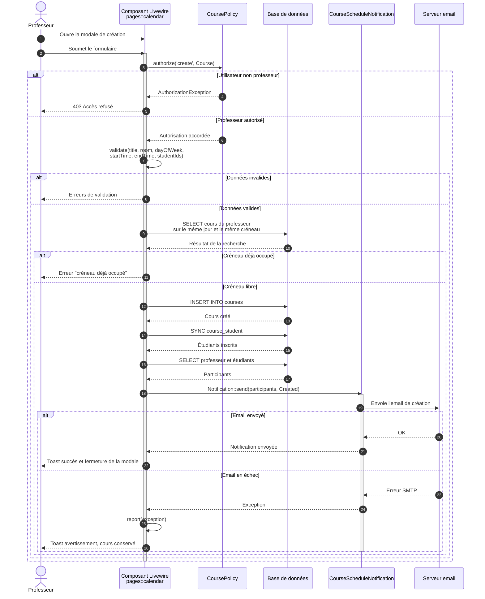

# Corrigé : création d'un cours avec notifications

## 1. Fichiers de référence

| Rôle | Fichier |
| --- | --- |
| Composant et logique | `resources/views/pages/⚡calendar.blade.php` |
| Autorisation | `app/Policies/CoursePolicy.php` |
| Modèle | `app/Models/Course.php` |
| Notification | `app/Notifications/CourseScheduleNotification.php` |
| Email | `resources/views/mail/course-schedule.blade.php` |
| Tests de référence | `tests/Feature/CourseCreationTddTest.php` |

Le composant Livewire contient la validation, le contrôle de conflit, l'enregistrement, l'inscription des étudiants et l'envoi de la notification. Il n'y a pas de contrôleur dédié.

Le fichier de référence est `tests/Feature/CourseCreationTddTest.php`. Les étudiants rendent `tests/Feature/CourseCreationTest.php`.

## 2. Diagramme de séquence corrigé



Le diagramme est aussi disponible dans `docs/tdd/creation-cours/diagramme-sequence.mmd`.

## 3. Lecture du diagramme

- L'autorisation est vérifiée avant toute écriture. Un étudiant reçoit une réponse 403. La politique est contrôlée à l'ouverture de la modale et de nouveau à l'enregistrement.
- La validation des champs passe avant le contrôle de conflit.
- Le contrôle de conflit interroge les cours du professeur sur le même jour. Il ne vérifie pas la salle.
- Le cours est enregistré avant l'envoi de l'email. Les deux écritures en base sont le cours et la table pivot `course_student`.
- La notification est envoyée dans un bloc `try/catch`. Une erreur SMTP est journalisée avec `report()` mais ne supprime pas le cours.
- Le succès et l'échec de l'email produisent deux toasts différents.

## 4. Découpage TDD

| Cycle | Comportement | Test | Code minimal ajouté |
| --- | --- | --- | --- |
| 1 | Créer un cours et inscrire les étudiants | `un professeur crée un cours et inscrit les étudiants` (persistance seule) | `saveCourse()`, `$course->save()`, `students()->sync()` |
| 2 | Interdire la création à un étudiant | `un étudiant ne peut pas créer un cours` | `Gate::authorize('create', Course::class)` et `CoursePolicy::create()` |
| 3 | Refuser les données invalides | `les données invalides sont rejetées` | `$this->validate([...])` avec les règles et les messages |
| 4 | Refuser un chevauchement de cours | `un professeur ne peut pas avoir deux cours qui se chevauchent` | `ensureTheSlotIsFree()` |
| 5 | Autoriser deux cours qui se touchent | `deux cours qui se touchent ne sont pas en conflit` | Comparaisons strictes `<` et `>` |
| 6 | N'inscrire que des étudiants | `seuls les étudiants peuvent être inscrits à un cours` | `Rule::exists('users', 'id')->where('role', Role::Student->value)` |
| 7 | Notifier le professeur et les étudiants | `Notification::assertSentTo` dans le test de création | `Notification::send()` et `CourseScheduleNotification` |
| 8 | Conserver le cours si l'email échoue | `le cours est conservé si l'email échoue` | `try/catch` autour de l'envoi et `report()` |

Pour un vrai cycle TDD, le cycle 1 ne doit pas encore vérifier les emails. On ajoute les assertions de notification au cycle 7, une fois la création verte. Le fichier de référence combine les deux pour rester compact.

## 5. Tests de référence

```php
<?php

use App\Enums\CourseChange;
use App\Enums\Weekday;
use App\Models\Course;
use App\Models\User;
use App\Notifications\CourseScheduleNotification;
use Illuminate\Support\Facades\Notification;
use Livewire\Livewire;

beforeEach(function () {
    $this->professor = User::factory()->professor()->create();
    $this->student = User::factory()->student()->create();

    $this->payload = [
        'title' => 'Algorithmique avancée',
        'room' => 'Amphi B',
        'dayOfWeek' => Weekday::Monday->value,
        'startTime' => '08:00',
        'endTime' => '10:00',
        'studentIds' => [],
    ];
});

test('un professeur crée un cours et inscrit les étudiants', function () {
    Notification::fake();

    $this->actingAs($this->professor);

    Livewire::test('pages::calendar')
        ->call('openCreateModal')
        ->set($this->payload)
        ->set('studentIds', [(string) $this->student->id])
        ->call('saveCourse')
        ->assertHasNoErrors()
        ->assertSet('showCourseModal', false);

    $course = Course::query()->sole();

    expect($course->professor_id)->toBe($this->professor->id)
        ->and($course->title)->toBe('Algorithmique avancée')
        ->and($course->room)->toBe('Amphi B')
        ->and($course->day_of_week)->toBe(Weekday::Monday)
        ->and($course->starts_at)->toBe('08:00:00')
        ->and($course->ends_at)->toBe('10:00:00')
        ->and($course->students->pluck('id')->all())->toBe([$this->student->id]);

    Notification::assertSentTo(
        $this->professor,
        CourseScheduleNotification::class,
        fn (CourseScheduleNotification $notification): bool => $notification->change === CourseChange::Created,
    );

    Notification::assertSentTo(
        $this->student,
        CourseScheduleNotification::class,
        fn (CourseScheduleNotification $notification): bool => $notification->change === CourseChange::Created,
    );
});

test('un étudiant ne peut pas créer un cours', function () {
    $this->actingAs($this->student);

    Livewire::test('pages::calendar')
        ->call('openCreateModal')
        ->assertStatus(403);
});

test('les données invalides sont rejetées', function () {
    $this->actingAs($this->professor);

    Livewire::test('pages::calendar')
        ->set('title', '')
        ->set('room', 'Salle inconnue')
        ->set('dayOfWeek', Weekday::Sunday->value)
        ->set('startTime', '07:00')
        ->set('endTime', '06:00')
        ->call('saveCourse')
        ->assertHasErrors(['title', 'room', 'dayOfWeek', 'startTime', 'endTime']);

    expect(Course::count())->toBe(0);
});

test('un professeur ne peut pas avoir deux cours qui se chevauchent', function () {
    Course::factory()->for($this->professor, 'professor')->create([
        'day_of_week' => Weekday::Monday,
        'starts_at' => '08:00',
        'ends_at' => '10:00',
    ]);

    $this->actingAs($this->professor);

    Livewire::test('pages::calendar')
        ->set($this->payload)
        ->call('saveCourse')
        ->assertHasErrors([
            'startTime' => 'Ce créneau chevauche un autre cours que vous enseignez déjà.',
        ]);

    expect(Course::count())->toBe(1);
});

test('deux cours qui se touchent ne sont pas en conflit', function () {
    Course::factory()->for($this->professor, 'professor')->create([
        'day_of_week' => Weekday::Monday,
        'starts_at' => '08:00',
        'ends_at' => '10:00',
    ]);

    $this->actingAs($this->professor);

    Livewire::test('pages::calendar')
        ->set($this->payload)
        ->set('startTime', '10:00')
        ->set('endTime', '12:00')
        ->call('saveCourse')
        ->assertHasNoErrors();

    expect(Course::count())->toBe(2);
});

test('seuls les étudiants peuvent être inscrits à un cours', function () {
    $otherProfessor = User::factory()->professor()->create();

    $this->actingAs($this->professor);

    Livewire::test('pages::calendar')
        ->set($this->payload)
        ->set('studentIds', [(string) $otherProfessor->id])
        ->call('saveCourse')
        ->assertHasErrors(['studentIds.0']);

    expect(Course::count())->toBe(0);
});

test("le cours est conservé si l'email échoue", function () {
    Notification::shouldReceive('send')
        ->once()
        ->andThrow(new RuntimeException('SMTP indisponible'));

    $this->actingAs($this->professor);

    Livewire::test('pages::calendar')
        ->set($this->payload)
        ->call('saveCourse')
        ->assertHasNoErrors()
        ->assertSet('showCourseModal', false);

    expect(Course::count())->toBe(1);
});
```

## 6. Correspondance avec les règles d'acceptation

| Règle | Test |
| --- | --- |
| Création et inscription | `un professeur crée un cours et inscrit les étudiants` |
| Autorisation | `un étudiant ne peut pas créer un cours` |
| Validation | `les données invalides sont rejetées` |
| Conflit de professeur | `un professeur ne peut pas avoir deux cours qui se chevauchent` |
| Créneaux adjacents | `deux cours qui se touchent ne sont pas en conflit` |
| Rôle des inscrits | `seuls les étudiants peuvent être inscrits à un cours` |
| Notification | `Notification::assertSentTo` dans le test de création |
| Résilience email | `le cours est conservé si l'email échoue` |

## 7. Pièges fréquents

- **Croire qu'un test qui passe est un bon test.** Vérifiez qu'il échoue avant l'implémentation, pour la bonne raison.
- **Tester l'implémentation.** Testez le cours en base, la modale fermée, l'email envoyé. Ne testez pas les méthodes privées.
- **Utiliser `assertForbidden()` avec Livewire 4.** Cette assertion n'existe pas dans le composant de test. Utilisez `assertStatus(403)`.
- **Utiliser `<=` et `>=` pour les conflits.** Deux cours qui se touchent deviendraient en conflit. Utilisez `<` et `>`.
- **Oublier le format des heures.** Les heures sont stockées en `H:i:s`, donc `08:00` devient `08:00:00`.
- **Mocker la base de données.** Utilisez `RefreshDatabase` et les factories.
- **Utiliser `Notification::fake()` pour tester un échec.** Pour simuler une panne, utilisez `Notification::shouldReceive('send')->andThrow(...)`.
- **Relancer toute la suite à chaque micro-changement.** Ciblez le fichier ou le test en cours avec `php artisan test --compact --filter=...`.
- **Dessiner un diagramme idéalisé.** Le diagramme doit correspondre au code réel, y compris le `try/catch` autour de l'email.

## 8. Grille de correction

| Critère | Points |
| --- | --- |
| Diagramme nominal complet | 4 |
| Branches d'erreur : 403, validation, conflit, email | 3 |
| Cohérence entre diagramme et code | 3 |
| Tests centrés sur le comportement | 4 |
| Cycles rouges puis verts tracés | 3 |
| Code conforme aux conventions et à Pint | 2 |
| Suite de tests verte | 1 |
